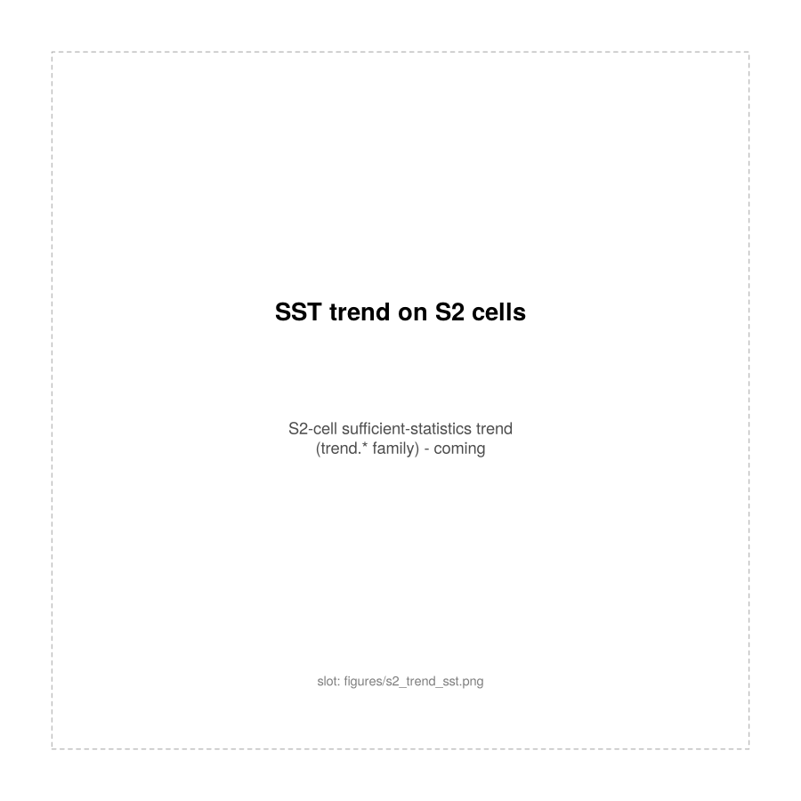
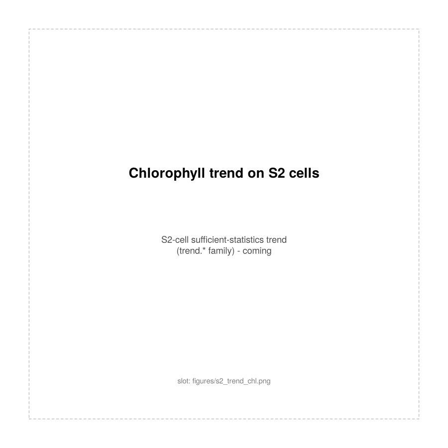
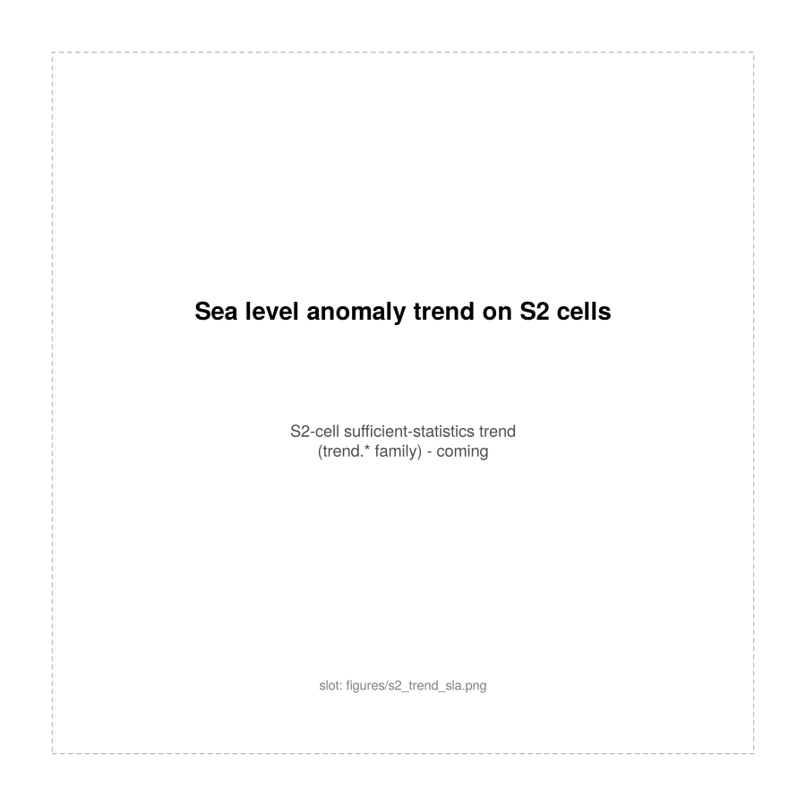

All maps are on the 25 km south polar stereographic sea ice grid
(EPSG:3412). Day numbers are day of the "ice year", which starts on 15
February.

## Sea ice seasonality

::: {layout-ncol=2}

:::

Retreat is the first day after which concentration stays below 15% for the
rest of the ice year; trends are least squares over all available years
(the 1987 ice year is excluded by a gap in the passive microwave record).

## The bloom after retreat

::: {layout-ncol=2}

:::

Off-shelf cells with at least 5 seasons (10 for the year-to-year map);
pixels with sea ice within ~75 km during a composite are excluded from the
bloom metrics.

## Trends on S2 cells (coming)

The trend.* records compute sufficient statistics on a discrete global grid
(S2 cells), which gives exact, updatable trends from daily data without
storing the daily fields. These panels are reserved for those trends in
the same view as the seasonality and bloom maps above.

::: {layout-ncol=2}

:::

Each panel is a fixed file name (`site/figures/s2_trend_<var>.png`); writing
the real map to that name replaces the placeholder.
