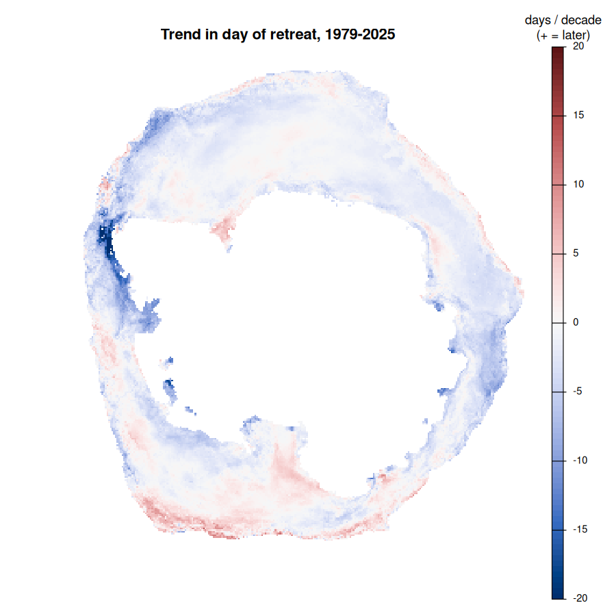
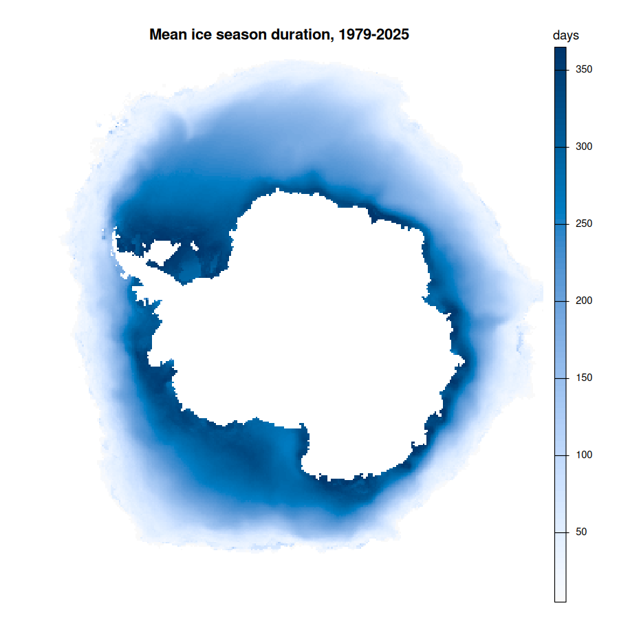
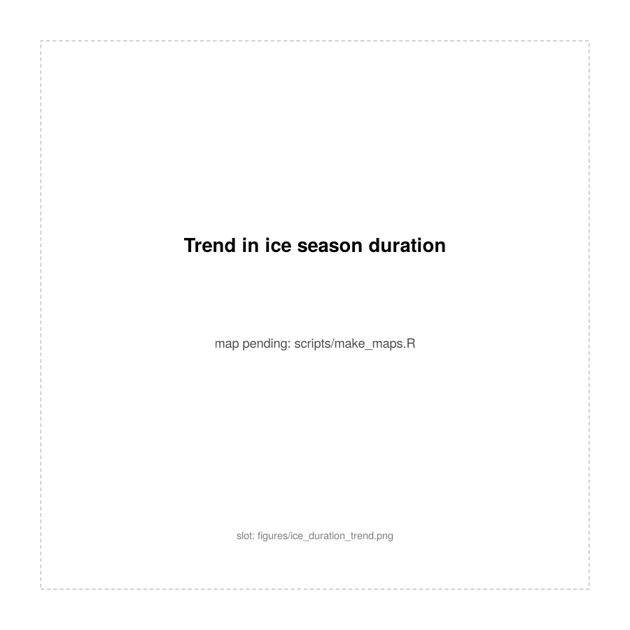
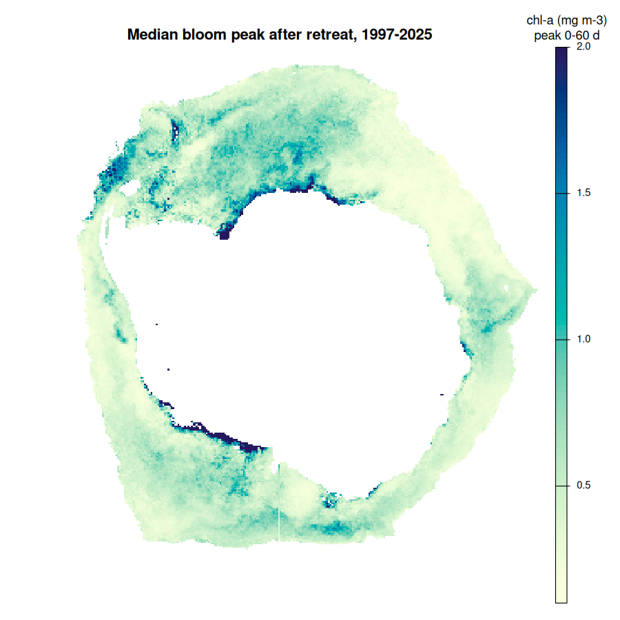
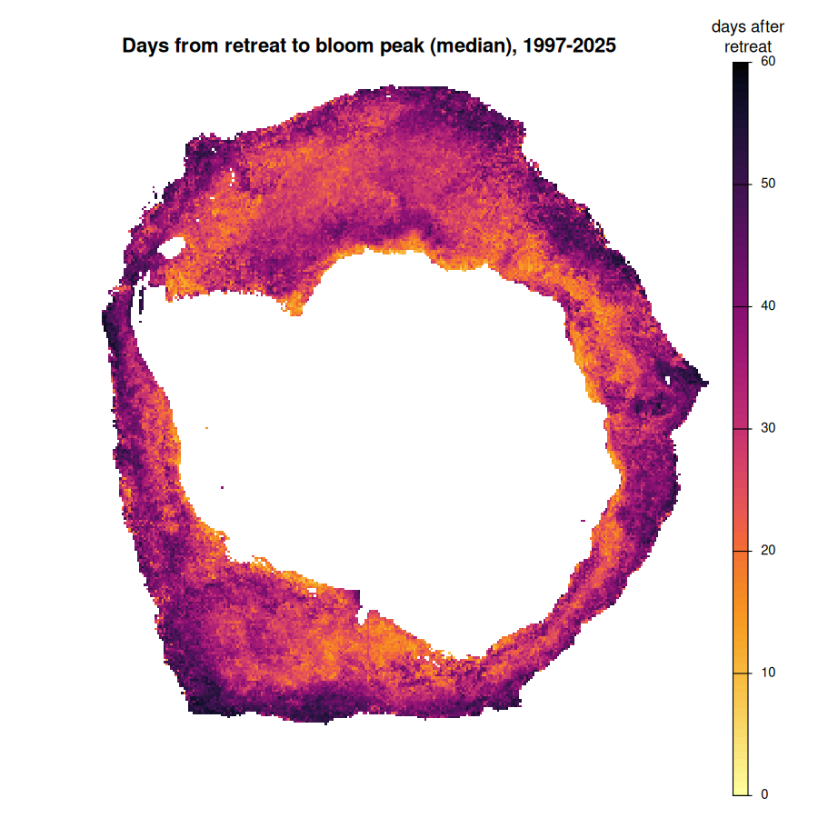
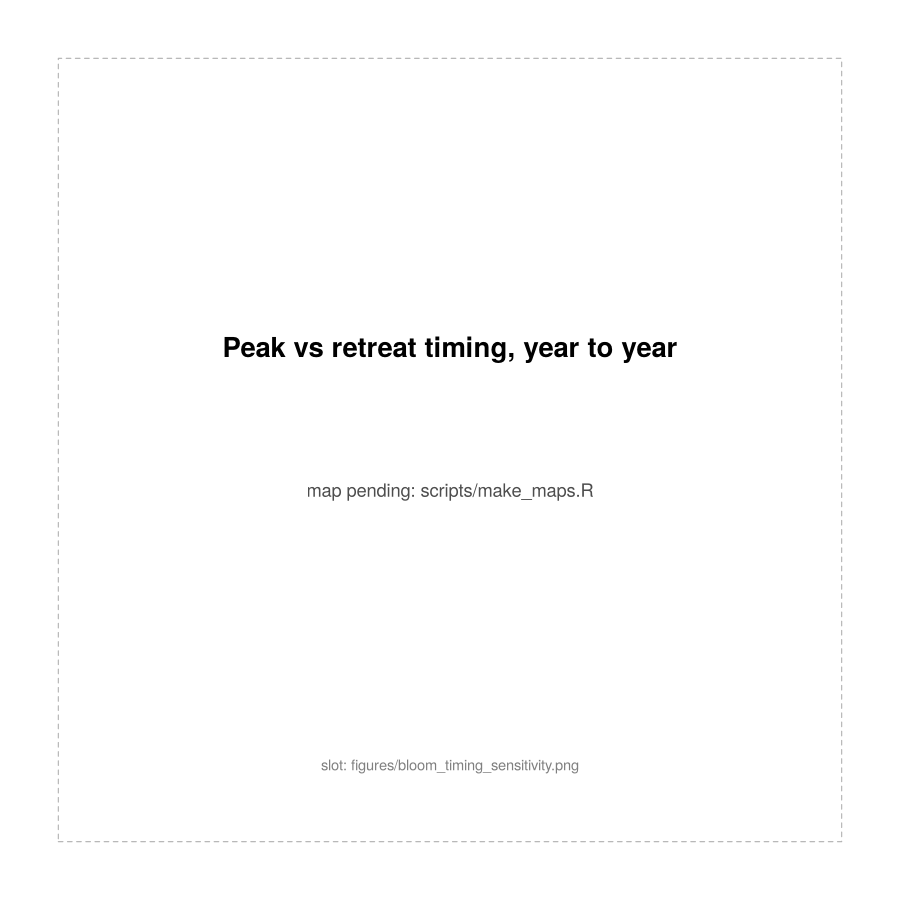

All maps are on the 25 km south polar stereographic sea ice grid
(EPSG:3412). Day numbers are day of the "ice year", which starts on 15
February.

## Sea ice seasonality

::: {layout-ncol=2}

:::

Retreat is the first day after which concentration stays below 15% for the
rest of the ice year; trends are least squares over all available years
(the 1987 ice year is excluded by a gap in the passive microwave record).
The well-known dipole shows clearly: much earlier retreat west of the
Antarctic Peninsula (Bellingshausen and Amundsen seas), later retreat over
much of the Ross Sea sector.

## The bloom after retreat

::: {layout-ncol=2}

:::

Off-shelf cells with at least 5 seasons (10 for the year-to-year map);
pixels with sea ice within ~75 km during a composite are excluded from the
bloom metrics.

The year-to-year map explains why the overall correlation between retreat
timing and bloom peak is near zero: it is the sum of coherent regions of
opposite sign. In much of the outer pack, where retreat comes in spring, a
*later* than usual retreat goes with a *bigger* peak (red) - more light and
shallower mixing by the time the ice goes. Further south, where retreat is
already late, a later retreat goes with a *smaller* peak (blue) - less of
the season left. The highest peaks sit along the coast and shelf break of
the Weddell and Ross seas.

::: {.callout-note}
A one-cell seam along 180 degrees longitude (bottom centre) is an artefact of
regridding the chlorophyll at the antimeridian, to be fixed.
:::

## Trends on S2 cells

The trend.* records compute sufficient statistics on a discrete global grid
(S2 level-5 cells, about 290 km), which gives exact, updatable trends from
daily or 5-day data without storing the fields. Each record runs on a
schedule on Setonix and publishes its sums to Acacia; the panels below are
drawn from each record's published cell export (trend of annual means, by
least squares) in the same south polar view as the maps above.

::: {layout-ncol=2}
)](figures/s2_trend_sst.png)

)](figures/s2_trend_chl.png)

)](figures/s2_trend_sla.png)

:::

Read with care in the seasonal ice zone. SST there is held near freezing
under ice, so the slight cooling ring is mostly the open-water months. The
strong positive chlorophyll ring is not yet a result: an annual mean of
ocean colour only sees the months with light and open water, and which
months those are has itself changed with the ice. A like-for-like trend
needs the sums restricted to a fixed season (or weighted by days since
retreat, as in the bloom analysis above); the sums support that without
recomputation.

The sea ice panel is this project's own record on the same engine: daily
NSIDC CDR (G02202 v6) concentration summed onto S2 cells with pixel-area
weights, read in place through a published index of the source files
(see `pawsey/README.md`). Its trend is of the annual mean concentration,
1979-2025, and it shows the same dipole as the retreat trend map above -
strong loss west of the Antarctic Peninsula (Bellingshausen, extending to
the Amundsen), gain over the Ross Sea - from an independent pipeline.

Drawn by `scripts/s2_trend_maps.R`, which reads the `docs/data/cells-*.json`
exports of each record and `site/data/cells-cdr-sic.json` for sea ice.
