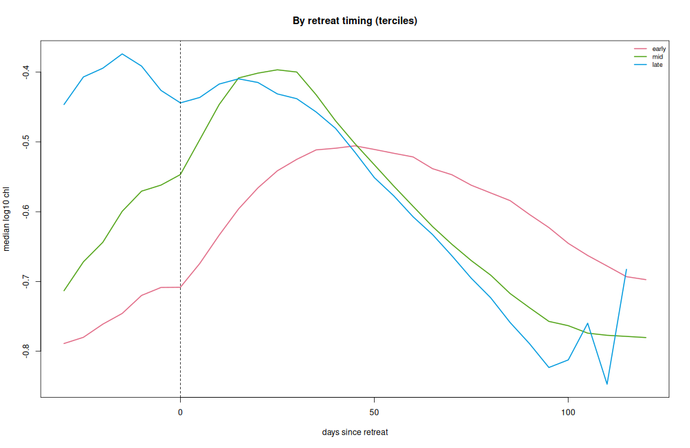
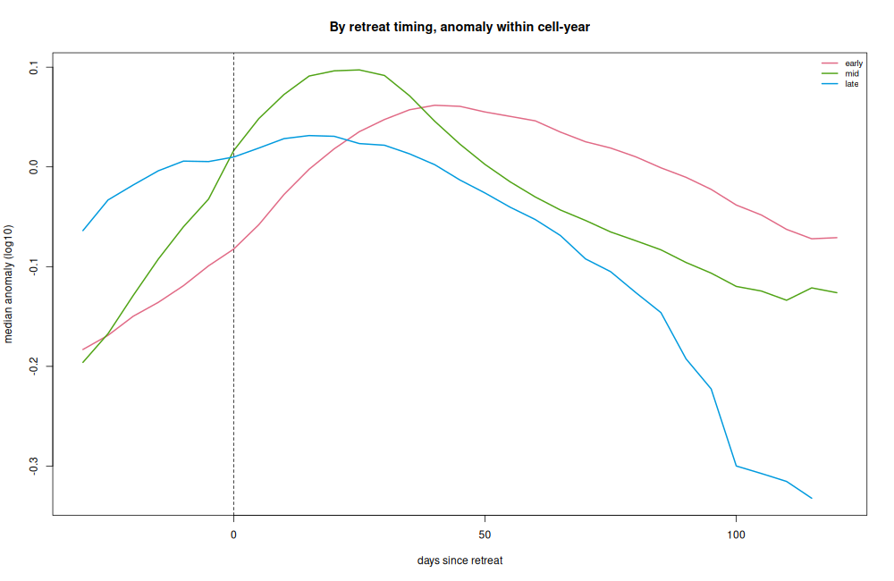
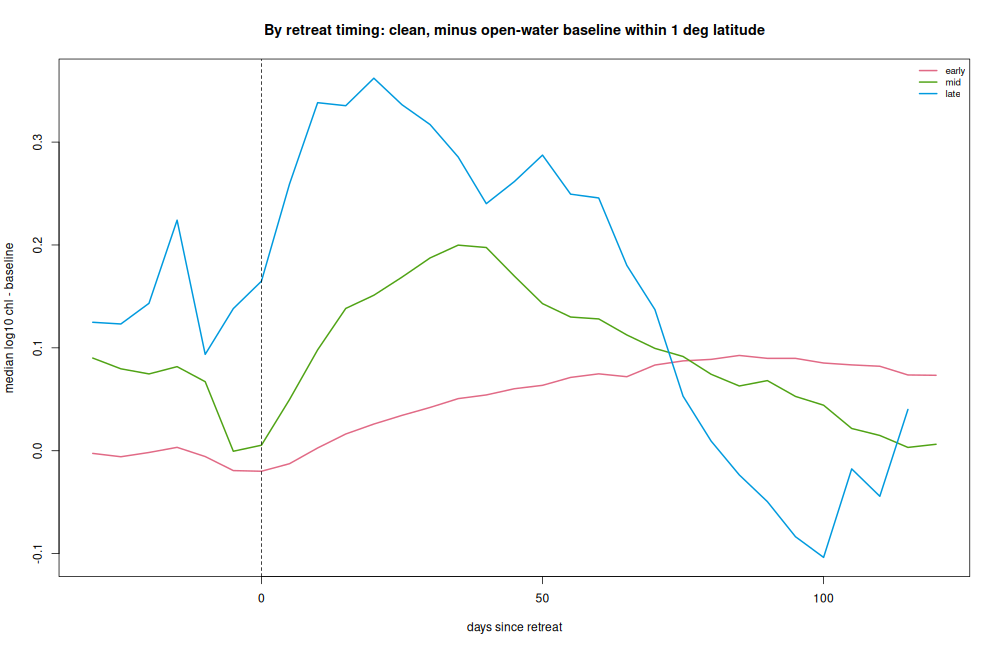
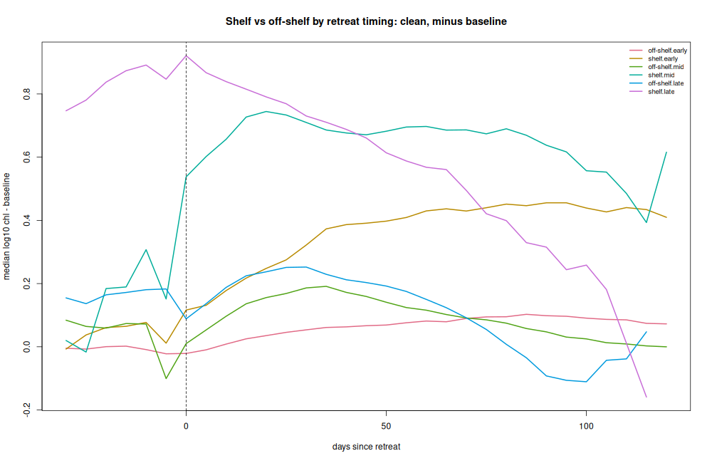
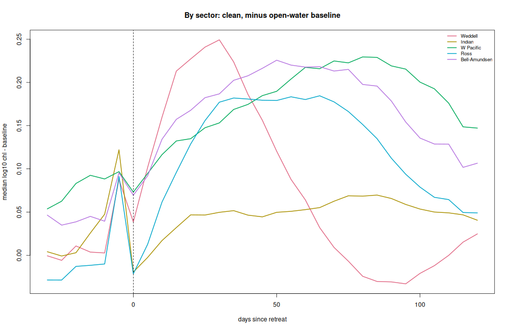
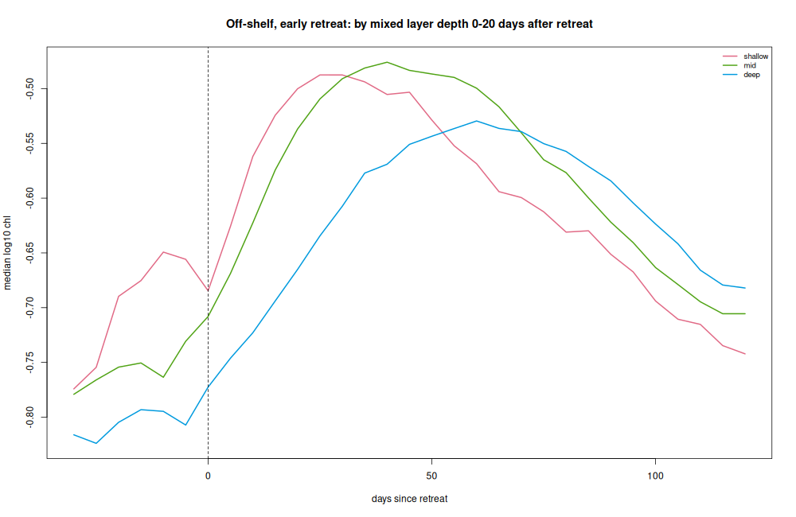

Medians of log~10~ chlorophyll-a in 5-day bins of days since retreat (dsr),
over ice years 1997-2025. "Early", "mid" and "late" are terciles of retreat
day over all cell-years. Full tables are in the repository under
`results/`.

## The bloom curve and retreat timing

| retreat tercile | before retreat (mg m^-3^) | peak (mg m^-3^) | peak, days after retreat | shape |
|---|---|---|---|---|
| early | 0.18 | 0.31 | ~45 | slow rise, broad, long tail |
| mid   | 0.23 | 0.40 | ~25 | sharpest, largest rise |
| late  | 0.39 | 0.39 | ~15 | little rise above a high level |

With each cell-year's own mean removed (the shape without the level), the
peak moves earlier as retreat gets later (45, 25, 15 days):

## Contamination, season and place

**Ice-edge contamination.** 85% of rows have no ice within ~75 km during
the 5-day composite. Removing the rest raises the pre-retreat level (late
tercile: log~10~ -0.41 to -0.28), so ice-adjacent pixels read lower, not
higher: the high pre-retreat chlorophyll of late-retreat cells is real.

**Season.** To separate retreat from the seasonal cycle, chlorophyll is
compared with open water (cells with no ice season that year) at the same
5-day composite, sector and latitude band. With the baseline restricted to
within 1 degree of latitude, off-shelf blooms rise to about 1.2x (early,
slow, dsr ~85), 1.4x (mid, dsr ~35) and 1.8x (late, dsr ~20) the
open-water level.

**Place.** The continental shelf (shallower than 1000 m; ~5% of rows)
carries the strongest signal: mid-retreat shelf water jumps at retreat to
~5x the open-water level and stays there for two months; late-retreat
shelf water is already ~7x before the formal retreat date (polynyas and
coastal leads). By sector, the Weddell responds most and earliest off the
shelf, the Indian sector least.

## Ocean state after retreat (reanalysis)

Mixed layer depth, surface temperature and salinity from a daily ocean
reanalysis, averaged over the 20 days after retreat at each cell, against
the bloom peak (max over dsr 0-60). Mixed-layer terciles are taken within
each retreat-timing tercile so the two are not confounded; 694,737 off-shelf
cell-years.

- **Early retreats:** the deepest third (median 116 m) peaks ~0.1 log~10~
  (~20%) lower. Within sector, deeper mixing lowers the peak most in the
  Ross (rank correlation -0.35) and Bellingshausen-Amundsen (-0.28) sectors,
  and fresher surface water raises it (-0.13 to -0.19 with salinity in the
  Weddell, Ross and Bellingshausen-Amundsen).
- **Mid and late retreats:** mixed layers are already shallow (median
  15-43 m) and the physical state explains little (|rho| < 0.16 within
  sector).
- **Pooled across sectors**, saltier water seems to go with more chlorophyll
  (+0.12 to +0.18), but this disappears within sector: it is a contrast
  between regions, not a process.

## Year to year at the same place

Retreat day varies by ~12-24 days (standard deviation) from year to year at
a place. Using each cell's departures from its own mean:

- An earlier than usual retreat lowers the peak in the Weddell and Ross
  seas (15+ days early: about -0.07 log~10~, ~15%); elsewhere the effect is
  flat or mixed. Overall the year-to-year rank correlation is near zero.
- Departures in mixed layer depth, temperature and salinity are all weakly
  related to departures in the bloom (|rho| <= 0.11).
- For early retreats, more daylight at the retreat date goes with a higher
  peak (rho +0.11 pooled).

The amplitude of the rise (peak minus the 30 days before retreat) falls
strongly with later retreat, but most of that is the pre-retreat window
moving through the season; it is not used as evidence here.

## Caveats

- Days since retreat and retreat timing are confounded with calendar date
  and place; the open-water baseline and the within-cell analyses address
  this only partly.
- Ocean colour is sparse near the ice and in the weeks after retreat;
  pixels with ice nearby are excluded from the bloom metrics.
- The ocean state comes from a reanalysis with few observations under or
  near the ice; light (beyond day length) and iron are not represented.
- The concentration product combines two algorithms and takes the larger,
  so retreat dates are a few days later than with either alone.
